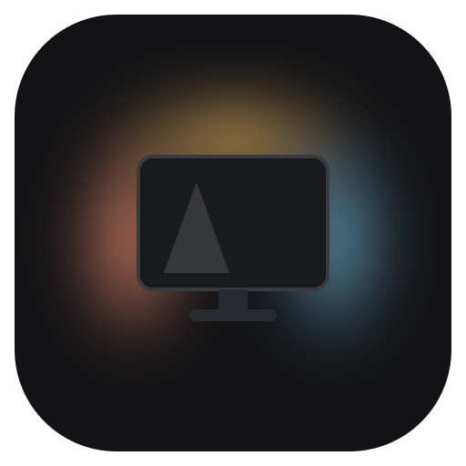
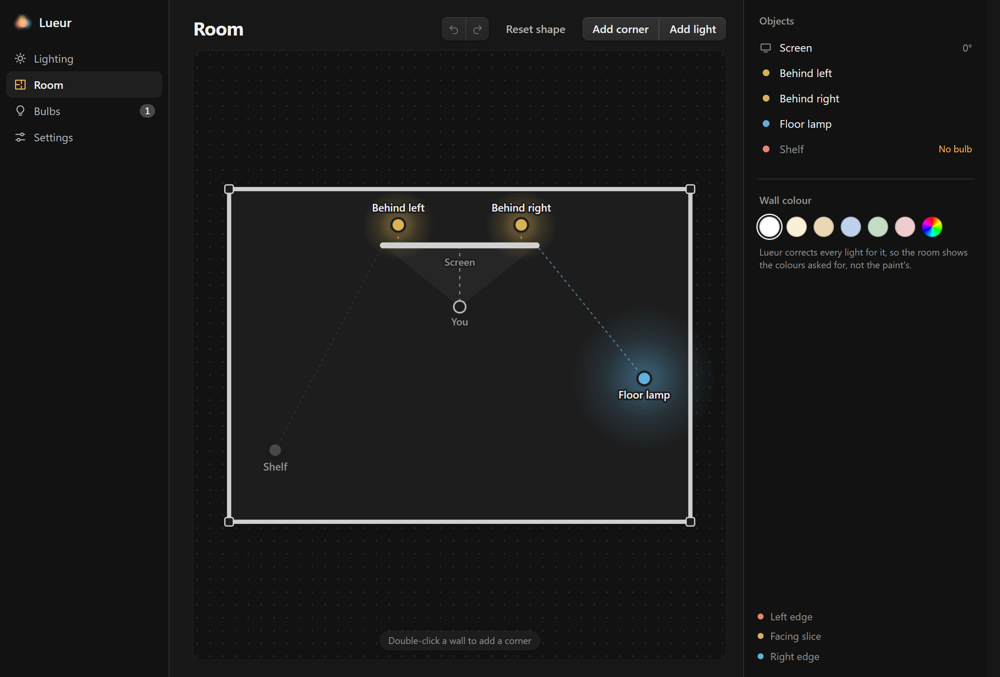
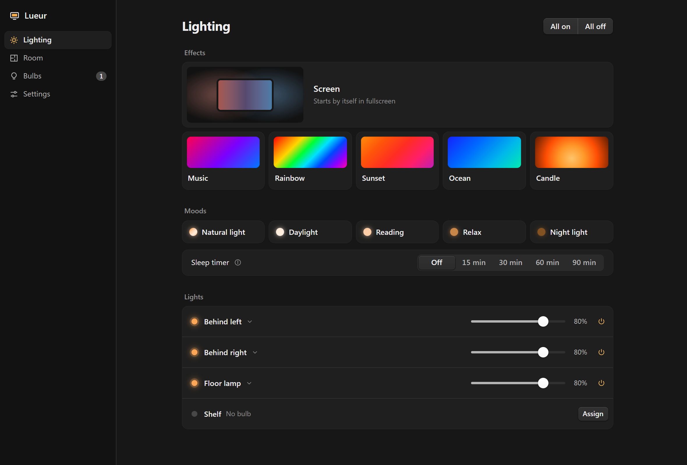
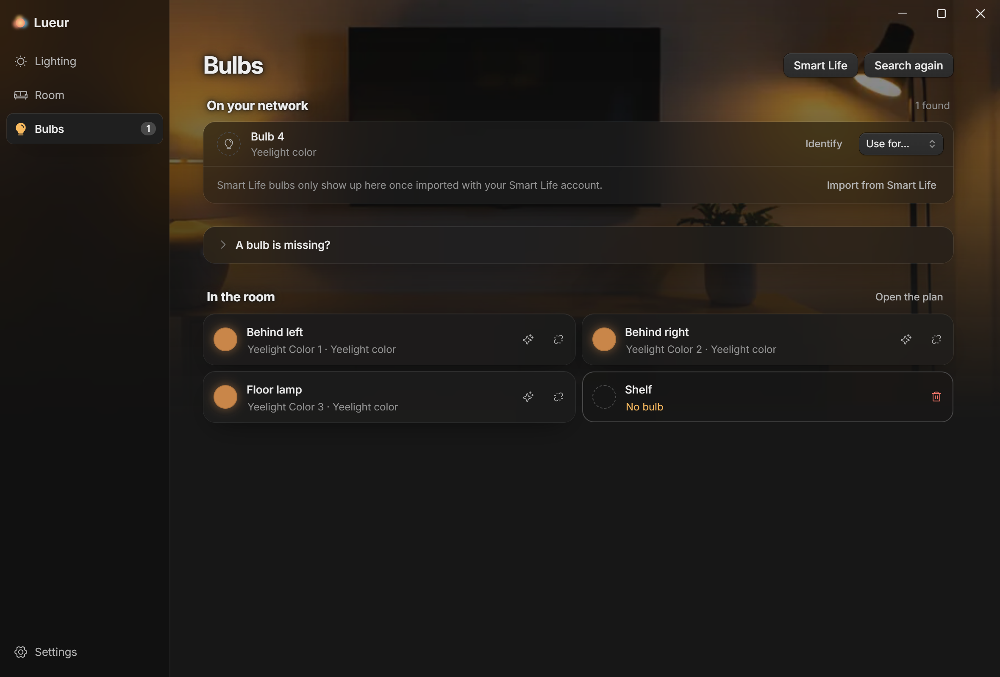
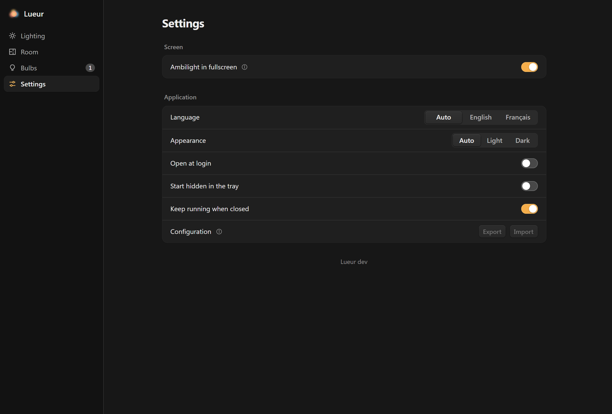

# Lueur

**A low-latency ambilight for your smart bulbs, made for cosy night gaming.**

Draw your room, place your screen and lights, pick your bulbs, and the light
around you follows what's on screen.

[**Download the latest version**](https://github.com/Alegzandr/lueur/releases/latest)

*Windows · macOS · Linux, free and open source*

 

<picture>
  <source media="(prefers-color-scheme: light)" srcset="docs/screenshots/room-light.png">
  
</picture>

---

## Why Lueur

The colours on screen reach your bulbs many times a second. Yeelight bulbs
run in *music mode*, which has no rate limit, so there is no visible delay.

You sketch your room, place the screen and drop each light where it really
stands. A lamp right behind the screen mirrors its own slice of the picture;
one across the room glows softly with the whole scene. On Windows the
Ambilight turns on by itself when a game or a video goes fullscreen, and
gives every light back what it was showing when it ends.

When you aren't playing, the same window runs effects (Music, which plays
the track on your lights like a stage, Rainbow, Sunset, Ocean and Candle)
and moods (Natural light, Daylight, Reading, Relax and Night light), on the
whole room or on the lights you pick. Each bulb also has its power,
brightness, white and colour, here or in the tray menu, and a sleep timer
fades everything off at night.

Lueur only reads the screen, the way OBS or Discord do, so it is safe to run
next to anti-cheat ([details below](#competitive-games-and-anti-cheat)). It
is a ~10 MB tray app that installs without admin rights and keeps itself up
to date.

## A look around

<table>
  <tr>
    <td width="50%">
      <picture>
        <source media="(prefers-color-scheme: light)" srcset="docs/screenshots/lighting-light.png">
        
      </picture>
      
<b>Lighting</b>: start the Ambilight, pick an effect or a mood,
      and adjust each light.

    </td>
    <td width="50%">
      <picture>
        <source media="(prefers-color-scheme: light)" srcset="docs/screenshots/room-light.png">
        
      </picture>
      
<b>Room</b>: a floor plan you draw on. Drag the lights, the corners
      and the screen; the glows show what each light will mirror.

    </td>
  </tr>
  <tr>
    <td width="50%">
      <picture>
        <source media="(prefers-color-scheme: light)" srcset="docs/screenshots/bulbs-light.png">
        
      </picture>
      
<b>Bulbs</b>: Lueur finds the bulbs on your network. Identify one
      to see which is which, then give it a place in the room.

    </td>
    <td width="50%">
      <picture>
        <source media="(prefers-color-scheme: light)" srcset="docs/screenshots/settings-light.png">
        
      </picture>
      
<b>Settings</b>: automatic Ambilight, English or French, light or
      dark, start at login, and a backup of your setup.

    </td>
  </tr>
</table>

## Get started

### 1. Install

Grab the file for your system from the
[latest release](https://github.com/Alegzandr/lueur/releases/latest):

| System | File | What to do |
|---|---|---|
| **Windows** | `Lueur_…_windows_x64_setup.exe` | Run it. Lueur installs itself for your account (no admin rights, no wizard) and opens. |
| **macOS** | `Lueur_…_macos_universal.zip` | Unzip it and move **Lueur** to *Applications*. |
| **Linux** | `Lueur_…_linux_x86_64.AppImage` | Make it executable (`chmod +x`) and run it. |

From then on Lueur **updates itself**: each launch checks for a new version,
verifies its signature and installs it before the app opens. It only ever
moves forward: an older version is refused, even one properly signed.

The release process can sign and notarize the Mac app once an Apple
developer certificate is set up, but the Mac app published so far is not
signed. The first launch needs your go-ahead in *System Settings → Privacy
& Security*, and after an update macOS may ask again for the microphone
(Music effect) and for the Keychain where Lueur keeps its key.

### 2. Add your bulbs

Open **Bulbs**: Lueur searches your network straight away. Add the bulbs you
want; **Identify** makes one flash so you know which is which.

Some bulbs need one thing first:

| Bulbs | Before searching |
|---|---|
| Yeelight, Govee | Turn on **LAN Control** in their phone app. |
| Philips Hue | Press the button on the bridge when Lueur asks. |
| Nanoleaf | Hold the controller's power button for 5 to 7 seconds when Lueur asks. |
| Smart Life / Tuya | Use **Smart Life** on the Bulbs page ([see below](#smart-life--tuya-bulbs)). |

### 3. Place them in the room

Open **Room**. Drag the **screen** to where your monitor is, drag **You** to
your seat to turn the screen towards you, and drag each **light** to where it
really stands. New bulbs start in a row behind the screen, the most common
setup.

Each light also has a **height** (floor to ceiling), which picks the part of
the picture it follows: a lamp on the floor mirrors the bottom of the screen,
one on a shelf the top.

### 4. Start

Back on **Lighting**, click the **Ambilight** tile (or press
<kbd>Ctrl</kbd>/<kbd>⌘</kbd> + <kbd>Enter</kbd>), then launch a game or a
film. On Windows you can skip this step: with *Ambilight in fullscreen* on
(the default, in **Settings**) it starts and stops by itself.

## Supported bulbs

| Family | Status |
|---|---|
| Yeelight Color | ✅ tested |
| Smart Life / Tuya colour bulbs | ✅ tested (v3.3) |
| Philips Hue (through the bridge) | supported, not yet tested on hardware |
| WiZ | supported, not yet tested on hardware |
| LIFX | supported, not yet tested on hardware |
| Govee (LAN Control on) | supported, not yet tested on hardware |
| Nanoleaf | supported, not yet tested on hardware |

Everything is driven over your local network; no cloud is involved once a
bulb is set up. Tried one of the untested families? An
[issue](https://github.com/Alegzandr/lueur/issues) saying how it went helps a
lot.

### Smart Life / Tuya bulbs

Tuya bulbs only obey apps that know their *local key*, which the Smart Life
app keeps to itself. **Smart Life** on the Bulbs page fetches it once:

1. In the Smart Life app, open **Me → ⚙ → Account and Security → User Code**
   and type that code into Lueur.
2. Scan the QR code Lueur shows from the Smart Life app, and confirm.
3. Lueur lists the colour bulbs in your homes and keeps each one's id and
   local key, then signs out. No account token is stored; everything after
   that is local.

Bulbs someone shared with you one by one aren't visible this way: ask their
owner to add you to their home instead.

## Everyday use

- **Tray.** Closing the window keeps Lueur in the tray. Turn off *Keep
  running when closed* in Settings and closing quits instead, while
  minimising goes to the tray (on Windows and Linux; a Mac minimises to the
  Dock). The tray menu says what the lights show, starts and stops the Ambilight
  and the effects and applies a mood, so you never have to leave a game.
- **At login.** *Open at login* and *Start hidden in the tray* in Settings;
  each light picks up the effect it was left playing.
- **Keyboard.** <kbd>Ctrl</kbd>/<kbd>⌘</kbd> + <kbd>1</kbd>–<kbd>4</kbd>
  switches page, <kbd>Ctrl</kbd>/<kbd>⌘</kbd> + <kbd>Enter</kbd> starts or
  stops. On the room plan, arrows nudge the selection (<kbd>Shift</kbd> for
  bigger steps), <kbd>Delete</kbd> removes it, <kbd>Esc</kbd> deselects, and
  holding <kbd>Shift</kbd> while turning the screen snaps to 15°.
- **Mistakes.** Removing a light can be undone, and the room plan has undo and
  redo. Changes made while effects play come with a one-click
  *Apply*.
- **Music.** On Windows the Music effect listens to the computer's own sound,
  so it follows any song or game: the default output, another one, or only
  what one application plays (Settings, *Sound source*), so a call or a
  notification stays out of the show. On macOS and Linux it listens to the
  microphone, or another input. It hears the kick, the snare and the hi-hats apart, finds the
  tempo and sends each beat a touch early so it lands with the sound, and
  plays the same whatever the volume. Each light gets a part from where it
  stands: the quick ones near the screen punch the beat in patterns that
  travel across the room, slow bulbs (Hue) and lamps out in the room wash
  it in colour, and a light at the ceiling answers the snare. A breakdown
  dims the room, a build climbs to white, and the drop lands on every light
  at once. White flashes can be turned off, and never come more than three
  a second.
- **Backup.** **Settings → Configuration** exports your setup to a file and
  imports it back, to keep a copy or move to another computer. The file holds
  no password or key, so it is safe to share; on another computer, pair the
  bridges and import Smart Life again.

## How the room mapping works

The room is a top-down floor plan, and the screen faces where you sit. For
each light Lueur reads three things off the plan:

- **Sideways position** picks the horizontal slice of the picture it mirrors.
- **Height** picks the vertical band.
- **Distance** widens that region: tucked behind the panel, a light mirrors a
  tight slice; out across the room, the whole picture. Far lights are also
  dimmer and calmer, because a far wall that flickers at 60 Hz reads as a
  fault.

Neighbouring lights hand over gradually when something bright crosses between
them, and colours are mixed the way light mixes, so reds and blues stay vivid
instead of turning muddy.

## Competitive games and anti-cheat

Lueur is built to run next to Vanguard, Easy Anti-Cheat, BattlEye, FACEIT and
the like without looking like a cheat:

- **Desktop capture only.** It reads whole monitors with the same system APIs
  as OBS and Discord. It never captures a game window directly.
- **Hands off the game.** No access to the game process, no memory reads, no
  injection, no hooks, no driver. Even when the Music effect follows one
  application's sound, Windows' audio service does the listening: Lueur
  never opens that application.
- **Output only.** No simulated keyboard or mouse input and no global
  hotkeys. The only output is colour sent to bulbs on your network.
- **No overlay.** Nothing is ever drawn over the game.

If a game hides itself from capture, the bulbs simply see a black screen;
switching the game to *borderless windowed* usually fixes it. Lueur never
tries to get around that.

## Privacy

Lueur talks to your bulbs on your local network, and only at private
addresses. Beyond that it sends exactly two kinds of traffic: the update
check to GitHub over HTTPS, and Tuya's sign-in while you import Smart Life
bulbs. That sign-in identifies itself with the app id Home Assistant uses
with Tuya, as Lueur has none of its own yet.

On your network, a Hue bridge is reached over HTTPS, and only ever with
the certificate it showed the first time Lueur saw it (at pairing, or for
a bridge paired with an older version, at its usual address). Nothing
vouches for that first sight: Lueur trusts it, then holds the bridge to
it. A bridge that does not answer over HTTPS is not paired, except the
first, round bridge, which has no HTTPS. That one and Nanoleaf controllers
only speak plain HTTP, so their credentials cross your network
unencrypted, and only to the address they were paired at. A bridge or
controller that turns up at a new address without proving who it is gets
nothing: the Bulbs page offers to pair it again with its button, or, when
nothing is pinned for it, to confirm that it is yours. A Hue bridge that
shows another certificate than its own can only be paired again.
Yeelight, WiZ, LIFX and Govee bulbs take commands from anyone on the
network, by design. Tuya bulbs get commands encrypted with their local
key, which itself never crosses the network, sent to wherever the bulb
was last found.

Bulb and bridge credentials never leave the app, nor go into an exported
configuration. On disk they are encrypted, with a key kept in your system's
keyring (Credential Manager on Windows, the Keychain on macOS, the Secret
Service on Linux). Without a keyring, on a Linux session with no Secret
Service for instance, they stay unencrypted in the settings file, which only
your account can read, and Settings says so.

Settings live in a `lueur` folder in your user config folder (`%APPDATA%` on
Windows, `~/Library/Application Support` on macOS, `~/.config` on Linux).

## Uninstalling

- **Windows:** *Settings → Apps → Installed apps → Lueur → Uninstall*. This
  removes everything but your settings.
- **macOS / Linux:** delete the app or the AppImage.

To remove your settings too, delete the `lueur` folder listed under
[Privacy](#privacy).

## Roadmap

- Hue Entertainment streaming instead of the REST API, and WLED.
- Testing WiZ, LIFX, Govee, Hue and Nanoleaf on real hardware.
- Optional per-light manual zone override.
- Multi-monitor spanning and per-zone brightness curves.

## Contributing

Building from source, the architecture, the logs and the release process
are in [docs/DEVELOPMENT.md](docs/DEVELOPMENT.md). To add a bulb family,
see [docs/ADDING_A_FAMILY.md](docs/ADDING_A_FAMILY.md).

## License

MIT, see [LICENSE](LICENSE).
